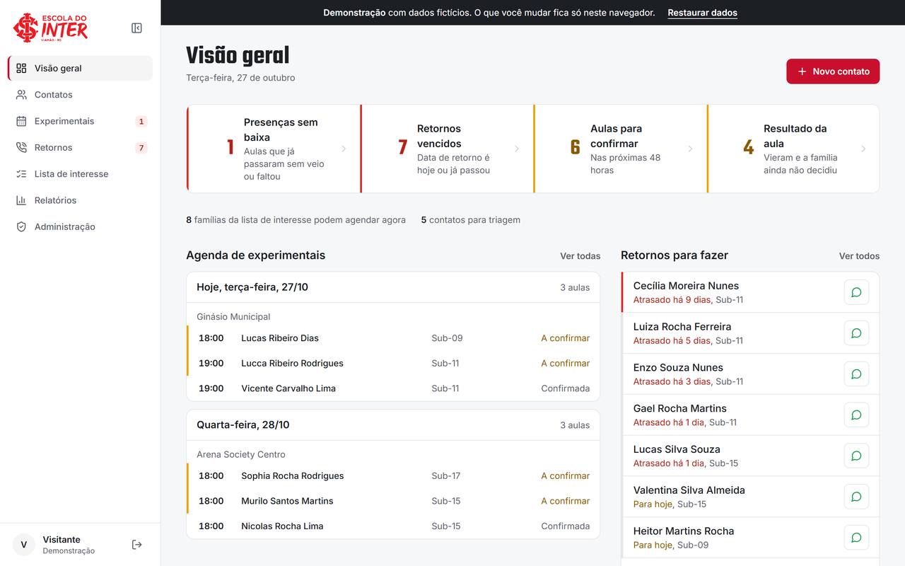
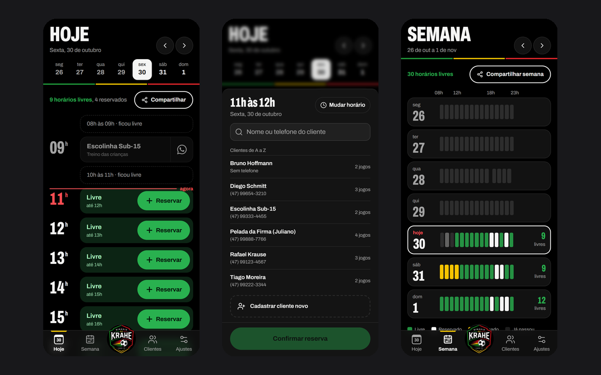
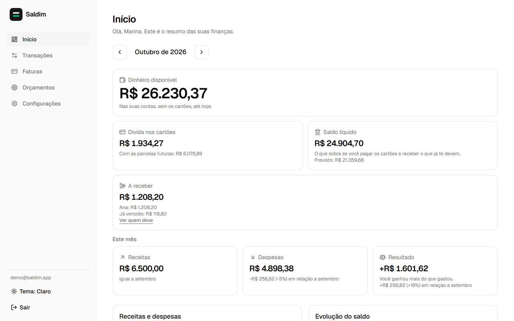
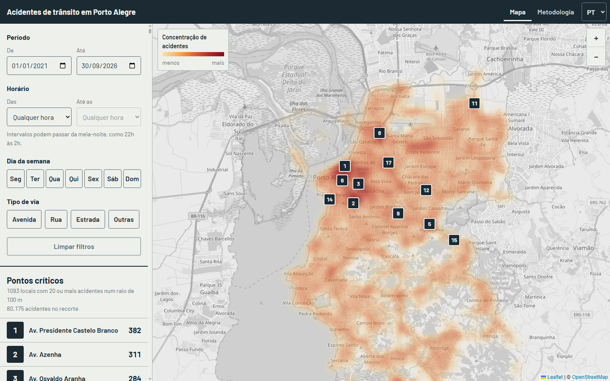

## Eduardo Ribeiro

Desenvolvedor full stack em Viamão/RS. Faço sistemas que pessoas usam todo dia: uma escola de futebol e uma quadra de futsal rodam no que eu construí.

<table>
  <tr>
    <td width="50%" valign="top">
      
       <b><a href="https://github.com/Eduarddoribeiro/interplus">CRM da escola de futebol</a></b> · <a href="https://crm-escola-demo.vercel.app">demo</a>
       Em uso na Escola Oficial do Inter: do agendamento da aula experimental à matrícula.
    </td>
    <td width="50%" valign="top">
      
       <b><a href="https://github.com/Eduarddoribeiro/agenda-quadra">De Primeira</a></b> · <a href="https://deprimeira-demo.vercel.app">demo</a>
       Em uso num ginásio: horários livres e reserva em três toques, pelo celular.
    </td>
  </tr>
  <tr>
    <td width="50%" valign="top">
      
       <b><a href="https://github.com/Eduarddoribeiro/saldim">Saldim</a></b> · <a href="https://saldo-orpin.vercel.app">demo</a>
       Finanças pessoais em que o saldo bate com o banco e com a fatura do cartão.
    </td>
    <td width="50%" valign="top">
      
       <b><a href="https://github.com/Eduarddoribeiro/acidentes-poa">Acidentes em Porto Alegre</a></b> · <a href="https://acidentes-poa.onrender.com">no ar</a>
       Pontos críticos de trânsito a partir de 87 mil registros abertos da Prefeitura.
    </td>
  </tr>
</table>

<b>Detalhes técnicos dos projetos</b>

 

**CRM:** React, PostgreSQL e Supabase. Os dados são de crianças, então o acesso é controlado no banco com Row Level Security, e o site público só cadastra por funções PL/pgSQL que validam e conferem a vaga numa transação.

**De Primeira:** Next.js, TypeScript, Drizzle e PostgreSQL, como PWA. Uma exclusion constraint impede reservas sobrepostas, mesmo que o código tenha um bug.

**Saldim:** React, TypeScript e Supabase com RLS. Cada compra cai na fatura certa pelos dias de fechamento, com parcelas e estornos, e há testes de ponta a ponta com Playwright.

**Acidentes em Porto Alegre:** Python, FastAPI, pandas e SQLite no back-end; React e Leaflet no front. A metodologia é aberta: registros descartados com o motivo e critério de ponto crítico tirado da análise exploratória.

**Análise de dados:** [churn em telecom](https://github.com/Eduarddoribeiro/Estudo-de-Caso-Churn) (um grupo com 60% de cancelamento) e [ENEM 2024](https://github.com/Eduarddoribeiro/analise-dados-enem-2024) (4,3 milhões de registros).

### Stack

### Contato

[LinkedIn](https://www.linkedin.com/in/eduardoribeirodefraga) · [eribeiro.fg@gmail.com](mailto:eribeiro.fg@gmail.com)
